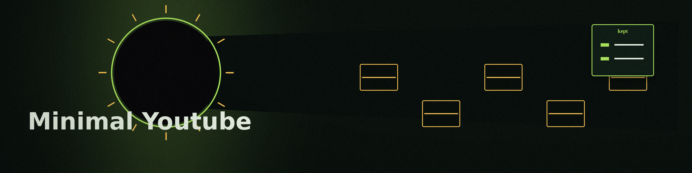

# Minimal-Youtube

This repo is a pointer, not code and not the extension itself. It holds
one link: the Chrome Web Store page for the MinimalTube extension, for a
cleaner YouTube interface.

```
https://chromewebstore.google.com/detail/minimaltube-productive-mi/bhnfblpekampnnmadaekkpacdplkgcnl
```

The link is reproduced exactly as written in this repo. It was not
re-verified in a browser in this pass, and nothing here installs or
configures the extension.
