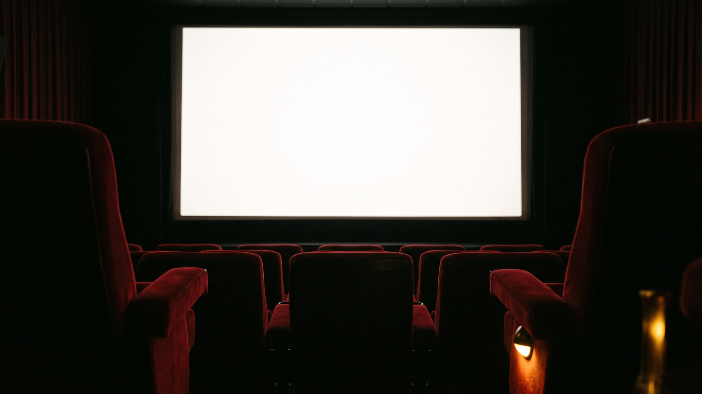
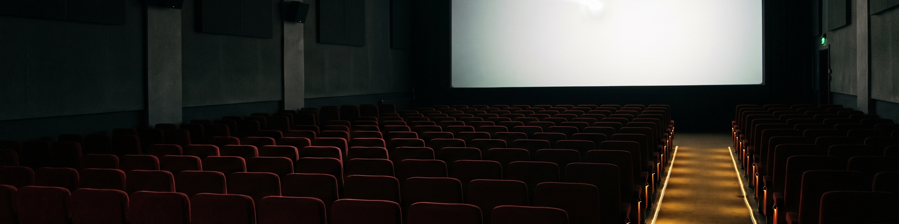
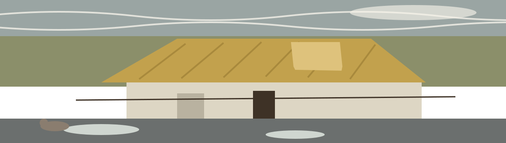

# Minimal-Youtube

<p align="center"></p>





This repo holds two things, both aimed at a calmer YouTube:

1. A pointer to the MinimalTube extension on the Chrome Web Store, which gives a cleaner YouTube interface. The extension lives at the linked store page, under its own authorship.
2. A small userscript of this repo's own, `minimal-youtube.user.js`, that hides YouTube clutter locally in your browser.

## The pointer

This repo is not the extension itself, and nothing here installs or configures it. The link is reproduced exactly as written in this repo. It was not re-verified in a browser in this pass.

```
https://chromewebstore.google.com/detail/minimaltube-productive-mi/bhnfblpekampnnmadaekkpacdplkgcnl
```

## The userscript

`minimal-youtube.user.js` is a Tampermonkey-style userscript for youtube.com. When a page loads, and again after each in-app navigation, it adds one style block that hides:

- the watch-page sidebar and its recommendations (`#secondary`, `#related`)
- the comments section
- Shorts shelves on the home page and in search results, the Shorts entry in the side navigation, and Shorts links inside result lists
- end-screen cards and annotation overlays on the player

It also lets the watch page use the width the sidebar gave up. The video, the player controls, search, and your subscriptions are untouched. The script reads nothing, sends nothing, and stores nothing; it only restyles the page in your own browser.

### Install

1. Install a userscript manager in your browser, such as Tampermonkey.
2. Open `minimal-youtube.user.js` from this repo and add it through the manager (Tampermonkey offers to install it when you open the raw file).
3. Visit youtube.com. To stop, disable or delete the script in the manager; every change it makes is a page style, so nothing remains behind.

### Honest limits

- YouTube changes its page markup over time. A selector can stop matching after a YouTube update, and a section this script hides today can come back until the selector is updated.
- The script hides Shorts shelves and links. It does not block a Shorts page if you open a Shorts link from outside the site.
- It runs only on `https://www.youtube.com/*` pages, in a browser where you installed it.
